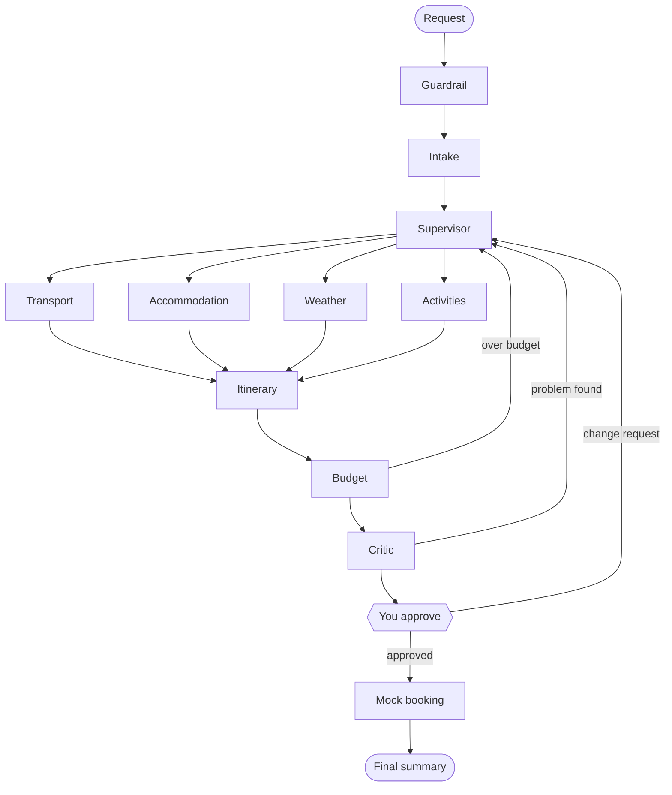

# AI Multi-Agent Travel Planner

Ask for a trip in plain language. A team of AI agents builds a day-by-day plan with travel, a hotel, weather,
activities and a budget, and **waits for your approval before anything is booked**. Booking is a mock.

> *"Plan a 5 day trip to Goa from Delhi in December, budget 60k for 2, love beaches and food"*

The first plan costs more than the budget, so the Budget agent sends it back to the Supervisor. The Supervisor re-plans on a
cheaper tier, the Critic checks the result, and you get an approval screen.

Built on **LangGraph** and **MCP**. It runs on free tiers and free data sources, and still works with no API keys at all.

## Highlights

- **Multi-agent orchestration:** a supervisor, parallel worker agents, shared typed state and conditional re-planning.
- **Human in the loop:** the run pauses for approval, accepts change requests in plain English, and survives a restart.
- **Hard rules in code, not in the model:** money, dates and overlaps are plain Python. An AI model only handles
  language and soft preferences, and every step has a rule-based fallback.
- **Resilience:** retries with backoff, provider fallback (Groq, Gemini, Ollama, rules), partial plans when a tool fails,
  idempotent booking.
- **Honest data:** every price is labelled *estimated* or *live*, with its source.
- **Production habits:** input guardrails, accounts, rate limits, per-run tracing, an evaluation set and automated tests.

## What you can do with it

| Feature | Summary |
|---|---|
| Dashboard | A trip form or plain language, agent status, and 10 popular destinations in India to start from |
| World destinations | A second page with 15 popular places around the world, and "Explore more places": type any place name to see it with its top sights and pictures |
| Plan any destination | A day-by-day itinerary with times, top sights, where to eat (veg and non-veg), a map and a budget breakdown |
| Choose how to travel | Flight, train, bus, car or bike, with price, time and estimated emissions side by side |
| Change the plan by chatting | "make it cheaper", "add 1 person", "go by train", "more food" |
| Get suggestions | Leave the destination out and compare places that fit your budget |
| Plan for a group | Everyone's likes and dislikes, with a fairness report |
| Trip toolkit | Packing list and local customs, emergency numbers and nearby help, document reminders, emissions, expense tracking |
| Live prices (optional) | Google Flights and Google Hotels prices through a free Tavily key |

Details of each feature are in [docs/features.md](docs/features.md).

## Tech stack

| Layer | Technology |
|---|---|
| Agents | Python, LangGraph (parallel fan-out, `interrupt()`, SQLite checkpoints), MCP tools |
| AI models | Groq, then Gemini, then Ollama, then plain rules (all optional) |
| Backend | FastAPI, SQLite |
| Frontend | React, built with esbuild; Leaflet with OpenFreeMap vector maps and OSRM road routes |
| Data | Open-Meteo, OpenStreetMap, Wikipedia, Wikivoyage, Tavily (optional) |
| Quality | pytest, evaluation set with a single-agent baseline |

## How the agents work



A blocked or incomplete request ends early with an explanation. Automatic re-plans are capped at 2 and so are your
change requests, so a run can never loop forever. See [docs/architecture.md](docs/architecture.md).

## Project structure

```
.
├── backend/
│   ├── app/
│   │   ├── main.py          # FastAPI application
│   │   ├── cli.py           # the planner in a terminal
│   │   ├── api/             # HTTP routes (v1) and a no-FastAPI fallback server
│   │   ├── agents/          # one file per agent
│   │   ├── graph/           # shared state, routing rules, LangGraph workflow
│   │   ├── tools/           # everything an agent can call, also served over MCP
│   │   ├── services/        # business logic: budget, itinerary, pricing, trip toolkit
│   │   ├── integrations/    # one client per outside data source
│   │   ├── rag/             # small local search over travel-guide text
│   │   ├── data/            # hand-checked reference data
│   │   ├── schemas/         # the shapes of trips, hotels, budgets and so on
│   │   ├── database/        # SQLite connection, tables, queries
│   │   ├── core/            # configuration, security, rate limits, caching, tracing
│   │   └── tests/           # grouped by layer
│   ├── evals/               # evaluation prompts, runner and latest report
│   ├── requirements.txt
│   └── Dockerfile
├── frontend/
│   ├── app/                 # page entry point and styles
│   ├── components/          # dashboard, account, planner, plan, toolkit, emergency
│   ├── hooks/               # account, planner, group and map state
│   ├── services/            # API client and formatting helpers
│   └── package.json
├── docs/                    # features, architecture, decisions, demo script
├── scripts/                 # double-click helpers for Windows
├── .env.example
└── docker-compose.yml
```

## Quick start

You need **Python 3.11 or newer** and **Node.js 18 or newer**.

**Windows, without typing commands:** run `scripts\install_requirements.bat` once, then `scripts\run_server.bat`.

**Any system, in a terminal:**

```bash
# 1. build the web page
cd frontend
npm install
npm run build

# 2. start the app
cd ../backend
python -m pip install -r requirements.txt      # a virtual environment is recommended
python -m uvicorn app.main:create_app --factory --port 8000
```

Open http://127.0.0.1:8000. After changing anything in `frontend/`, run `npm run build` again.

**API keys are optional.** Without them the planner runs in rule-based mode. To add them, copy `.env.example` to `.env`
in the project root and fill in what you have. Never commit `.env`.

**Docker:** `docker compose up --build` (Docker Compose 2.24 or newer). This setup has not been run yet.

**Terminal only** (from `backend/`):

```bash
python -m app "Plan a 5 day trip to Goa from Delhi in December, budget 60k for 2"
python -m app.api.stdlib_server --port 8000     # same API and page without FastAPI
```

## API

All routes start with `/api/v1`. FastAPI serves interactive documentation at `/docs`.

| Route | Purpose |
|---|---|
| `POST /plan` | Plan a trip: `{"request": "...", "group": [...]}` |
| `POST /approve/{thread_id}` | `{"action": "approve" \| "revise" \| "cancel", "feedback": ""}` |
| `GET /plan/{thread_id}` | Read a saved plan |
| `POST /booking/{thread_id}/cancel` | Cancel a mock booking (`{"confirm": true}` to confirm) |
| `POST /explore` | Show a place and its top sights, with pictures: `{"place": "Prague"}` |
| `/trip/{thread_id}/{tool}` | Trip toolkit: companion, emergency, documents, footprint, expenses |
| `POST /emergency` | Emergency numbers and nearby help (never needs sign-in) |
| `/auth/...`, `/me`, `/trips` | Optional accounts, saved preferences, "My trips" |
| `GET /health` | Engine, data mode and AI providers in use |

## Testing and evaluation

```bash
cd backend
python -m pytest              # offline and repeatable: tests never call outside services or use your keys
python evals/run_evals.py     # compares the agent graph with a single-agent baseline
```

On the 23 evaluation prompts (offline tools, fixed date) the multi-agent graph gets the expected outcome for **100%**,
against **61%** for a single agent with the same tools. Most of the gap comes from budget re-planning. The full
[report](backend/evals/report.md) also has AI-judge scores for preference matching (mean 3.5 out of 5).

The tests cover agents, tools, routing, retries, approval and resume, idempotent booking, parallel execution,
MCP parity, AI provider fallback and the HTTP layer. LangGraph and the dependency-free runner share the same agent
functions, and a test checks that both produce the same plans.

## Limitations

- Booking is a **mock**. Nothing is bought.
- Without a Tavily key, flight and hotel prices are **estimates**. Train, bus, car and bike are always estimates.
- Reading Google's travel pages through Tavily suits a demo. Check both providers' terms before commercial use.
- Plan quality outside the five hand-checked destinations depends on free map and guide data.
- Accounts are for local or demo use: no HTTPS, email verification or password reset.
- Open-Meteo is for non-commercial use, with attribution.

## Documentation

- [Features](docs/features.md): how each feature works and what it will not do
- [Architecture](docs/architecture.md): graph, state, resilience and security model
- [Design decisions](docs/decisions.md): choices made and their trade-offs
- [Demo script](docs/demo.md): a 3-minute walkthrough
