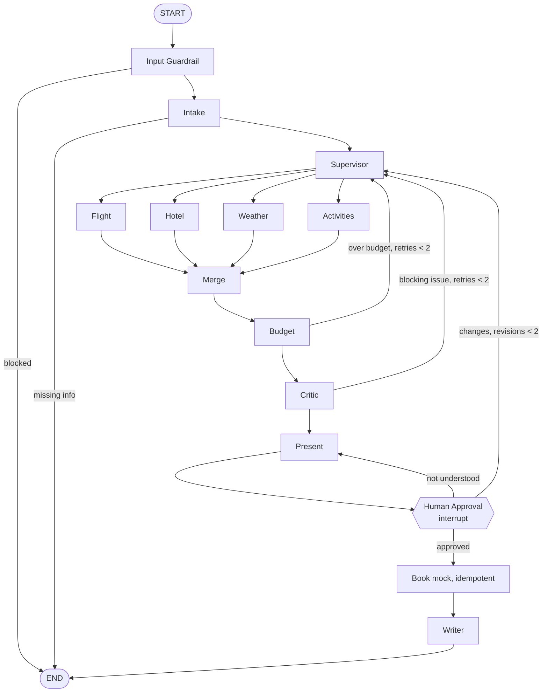

# Architecture

## Graph

## Why two engines share one set of nodes

`agents.py` holds every node as a plain function `fn(state, deps) -> update`. `routing.py` holds the conditional
edges as pure functions. Two thin shells execute them:

* `graph.py` wires them into **LangGraph** (parallel edges, join, `interrupt()`, SQLite checkpointer).
* `runner.py` executes the same nodes with a thread pool. It is the engine the unit tests run, the CLI/dev server
  can use, and the automatic fallback if LangGraph is missing or fails its startup self-check (`engine.py`).

`tests/test_graph_engine.py` asserts both engines produce identical plans, budgets and warnings.

## Shared state

One typed `TripState`. Workers write separate keys (`flight`, `hotel`, `weather`, `activities`), so parallel
writes never conflict. Only `log` and `warnings` are append-only (reducers). Nodes that decide a route
(`budget`, `critic`, `approval`) set `replan_reason`; routers only read it; the Supervisor consumes it.

| Key | Written by |
|---|---|
| `guardrail`, `status`, `message` | guardrail, intake, present, book |
| `constraints` | intake, approval (feedback) |
| `strategy`, `retries`, `fanout`, `replan_reason` | supervisor, budget, critic, approval |
| `flight`, `hotel`, `weather`, `activities` | one worker each |
| `itinerary` | merge |
| `budget_report` | budget |
| `critic_issues` | critic |
| `revisions`, `decision`, `approved`, `food_boost`, `notice`, `pending_approval` | present, approval |
| `booking` | book |
| `summary` | present (template), writer (final) |

## Control flow

* **Budget loop.** Budget totals flight + hotel + activities + food. If over budget and `retries < 2`, it sets
  `replan_reason = over_budget`; the Supervisor moves `normal -> cheaper -> cheapest`, clears stale results, and
  re-runs only flight, hotel and activities (weather is unaffected by price).
* **Critic.** Deterministic checks: dates, hotel nights, overlaps, activities per day (max 4), airport buffer,
  price traceability, totals. A blocking issue triggers a re-plan (sharing the same 2-retry counter).
  At the cap the plan is shown anyway with the unresolved issue as a warning.
* **Human approval.** `present` sets `awaiting_approval` and the graph pauses. Decisions: approve, cancel, or
  revise with free text. Feedback is parsed (`feedback.py`); unrecognised feedback does not consume a revision.
  After 2 revisions only approve/cancel remain.
* **Booking.** The key is a hash of thread, destination, dates, travelers and total. A second approve (double
  click, retry, restart) finds the stored booking and returns it; the tool is not called again.

## Resilience

* Tool calls go through `call_with_retry`: exponential backoff for retryable errors, none for invalid input.
* After retries a worker returns `{error, selected: None}` plus a warning. Merge/Budget/Critic degrade: the plan
  is built without that part, totals are flagged incomplete, and the user sees "Partial plan" warnings.
* Real-data tools (Open-Meteo, Wikivoyage, OSM) never raise; any failure returns offline estimates fast.
* LLM calls: backoff on 429/5xx/timeout, then next provider, then rules. Responses are schema-validated, cached
  in SQLite by prompt hash, and bounded by a per-run token budget and daily call counters.

## Security model

* Valid instructions come only from the user. Tool output (places, Wikivoyage text, OSM names) is data: it is
  sanitised (control characters, injection phrases, markup) before it reaches state or the UI.
* User text sent to an LLM is wrapped as data; the system prompt says never to follow instructions inside it.
* LLM output cannot change money: it can only reorder already-filtered candidates, fill missing intake fields
  (validated against the catalog and ranges), or add an overview whose rupee figures must match the plan.
* The UI renders every dynamic string with HTML escaping.

## MCP

`mcp_server.py` serves the five tools over stdio (`python -m travel_planner.mcp_server`). `McpClient` keeps one
persistent session in a background event loop. Tool errors travel as data (`{error, retryable}`) so the client
raises the same `ToolError` as the in-process client. Works with the v1 `FastMCP` and v2 `MCPServer` SDKs.
Switch with `TOOLS_MODE=mcp`; a test proves identical results.
